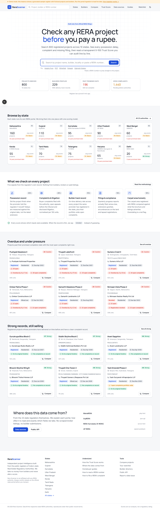

# Rera Scanner

**Check any RERA project before you pay a rupee.**

Rera Scanner indexes the public registers of India's state Real Estate Regulatory Authorities, normalises them into one model, and shows every project with its possession history, complaints, filings and a transparent 0–100 **Trust Score** that can be audited line by line. Built with Next.js 16, TypeScript, Tailwind v4 and SQLite (libsql / Drizzle).



## What it does

- **Search** by project name, builder, locality or registration number, with typeahead. Pasting a RERA number jumps straight to the project; `/verify/<number>` does the same as a deep link.
- **Project pages** with a possession timeline (registered → promised → revised → actual/today), the full score breakdown with evidence for every component, complaints and orders, extensions, unit mix with registered vs advertised carpet area, escrow bank, encumbrance, quarterly-report compliance, professionals, documents, and a "verify on the official portal" link.
- **State pages** with status counts, Trust Score distribution, per-district table, most active builders, overdue/strong/recent lists and a description of that portal.
- **Filtered listings** by district, status, type, score band, overdue and complaints, in grid or table view, sortable, with shareable URLs (plain GET forms, works without JS).
- **Builder directory and builder pages** with on-time delivery rate, delayed/lapsed projects and portfolio-wide open complaints.
- **Compare** up to three projects side by side; **watchlist** stored in the browser; dark mode.
- **Methodology page** publishing the full formula, **data-sources page** explaining each portal and showing recent sync runs, four **homebuyer guides**, and a free **JSON API** (`/developers`).
- SEO: per-page metadata and canonicals, JSON-LD, sitemap, robots, OG image.

## Trust Score (v1)

| Component | Weight | Measures |
| --- | --- | --- |
| Possession record | 35 | Delivery against the _original_ completion date declared at registration |
| Complaints & litigation | 25 | Complaints per 100 units, open complaints, tribunal appeals, disclosed litigation |
| Promoter track record | 15 | On-time rate across the promoter's concluded projects in the state |
| Filings & compliance | 15 | Quarterly progress reports filed vs due, extensions, encumbrance, lapsed registration |
| Carpet area consistency | 10 | Registered carpet area vs advertised carpet area |

Total = weighted mean over the components that had data; **confidence** = share of weight with data; below 50% the project is **Unrated**. Bands: Strong 75–100, Watch 50–74, Caution 0–49. Implementation: `src/lib/scoring/score.ts` (unit-tested in `tests/score.test.ts`). Full write-up with a worked example at `/methodology`.

## Quick start

```bash
npm install
cp .env.example .env.local
npm run db:seed        # creates data/rerascanner.db with the sample register and scores it
npm run dev            # http://localhost:3000
```

`npm run build` runs `scripts/ensure-db.ts` first, so a fresh clone builds without any manual step.

### Scripts

| Script | What it does |
| --- | --- |
| `npm run dev` / `build` / `start` | Next.js |
| `npm run db:seed` | Migrate and load the deterministic sample dataset (800 fictional projects, 10 states), then score |
| `npm run db:reset` | Delete the database file and seed again |
| `npm run db:score` | Recompute promoter aggregates and all scores |
| `npm run ingest -- --state gujarat` | Live ingestion from a state portal (see below) |
| `npm run test` / `lint` / `typecheck` | Vitest, ESLint, `tsc --noEmit` |

### Environment

```
DATABASE_URL=file:./data/rerascanner.db     # or a Turso libsql:// URL
DATABASE_AUTH_TOKEN=                        # for Turso
NEXT_PUBLIC_SITE_URL=https://your-domain    # canonical URLs, sitemap, OG
NEXT_PUBLIC_DATA_MODE=sample|live           # shows/hides the demo banner
INGEST_DELAY_MS=1500                        # politeness delay per portal host
GUJRERA_LIST_URL / GUJRERA_DETAIL_URL       # GujRERA JSON endpoints captured from DevTools
```

## Data: where it comes from

There is no national RERA database or official API; each state runs its own portal. Rera Scanner reads those public registers with one **adapter per portal family** and pushes everything through a single pipeline:

```
src/ingest/
  types.ts              NormalizedProject: the one shape every adapter emits
  pipeline.ts           upsert with content-hash change detection, sync_runs log, FTS rebuild
  scoreAll.ts           promoter aggregates + Trust Score snapshot for every project
  http.ts               polite fetch: per-host delay, retries, honest User-Agent
  parse.ts              date/area/status normalisers, label-value table reader, ASP.NET state
  adapters/
    maharashtra.ts      MahaRERA: server-rendered PHP, paginated search + detail tabs
    gujarat.ts          GujRERA: Angular SPA + JSON API (endpoints via env)
    karnataka.ts        K-RERA: Spring MVC, POST search per district
    htmlTable.ts        factory for server-rendered registers (WB, KL, TN, HR, DL, …)
    aspnet.ts           factory for ASP.NET WebForms portals (UP, TS, MP, RJ, AP, BR, CG, JH)
    sample.ts           deterministic fictional register for demos and tests
    index.ts            registry of live adapters
  sample/               the sample generator (fictional promoters, realistic reg-number formats)
```

```bash
npm run ingest -- --state gujarat                      # full state
npm run ingest -- --state maharashtra --district Pune --limit 50
npm run ingest -- --state karnataka --dry-run          # fetch and print, write nothing
npm run ingest -- --all                                # every adapter in the registry
```

**Important:** the live adapters were written against the publicly documented structure of each portal (see `docs/DATA-SOURCES-RESEARCH.md`) but could not be executed against the portals from the build environment, which had no outbound access to them. Treat the selectors and endpoint paths as a starting point: run a `--dry-run --limit 5` for a state, compare the output with the live page, and adjust the label lists in the adapter. The pipeline, scoring, search and UI are fully exercised by the sample adapter, which goes through the identical code path.

The research on how RERA aggregator sites (including ReraInspector) source their data, which portals use which technology, and which open-source scrapers document the endpoints is in **[docs/DATA-SOURCES-RESEARCH.md](docs/DATA-SOURCES-RESEARCH.md)**. The user-facing version is at `/data-sources`.

## Public API

All read endpoints are under `/api/v1` and return JSON with CORS enabled; documentation at `/developers`.

```
GET /api/v1/search?q=&state=&district=&status=&type=&band=&overdue=1&complaints=1&sort=&page=&pageSize=
GET /api/v1/projects/by-number/{reraNumber}
GET /api/v1/projects?ids=1,2,3
GET /api/v1/promoters?state=&q=&sort=&page=
GET /api/v1/promoters/{slug}
GET /api/v1/states
GET /api/v1/states/{state}
GET /api/v1/suggest?q=
```

## Project layout

```
src/app/                 routes (App Router)
  page.tsx               home
  search/                search results
  state/, state/[state]/, state/[state]/projects/
  projects/[slug]/       project detail
  promoters/, promoters/[slug]/
  compare/, watchlist/, verify/[number]/
  methodology/, data-sources/, guides/, developers/
  api/v1/                JSON API
  sitemap.ts, robots.ts, icon.svg, opengraph-image.tsx
src/components/          UI (Score, ProjectCard, Filters, Timeline, SearchBox, …)
src/db/                  schema (Drizzle), client (libsql), migrate (DDL + FTS5), queries
src/lib/                 states registry, scoring, formatting, site config
src/content/guides.ts    guide articles
scripts/                 seed, ingest, score, ensure-db
tests/                   vitest
```

## Deploying

Any Node host works. The simplest production setup is a persistent volume for `data/rerascanner.db` plus a cron that runs `npm run ingest -- --all` nightly; or point `DATABASE_URL` at Turso and run ingestion from a worker. Set `NEXT_PUBLIC_DATA_MODE=live` once real data is loaded to hide the demo banner. `.github/workflows/ci.yml` runs lint, typecheck, tests and build on every push; `.github/workflows/ingest.yml` is a manual/scheduled ingestion job you can enable once the adapters are verified against the live portals.

## Honesty notes

- The score is Rera Scanner's analysis, not a regulatory rating. Every page says so and links to the official portal.
- The demo dataset is fictional. Promoter and project names are generated; any resemblance to real companies is coincidental.
- If the authority's record is wrong, the site is wrong in the same way; corrections are a re-read of the portal, never a manual edit.
